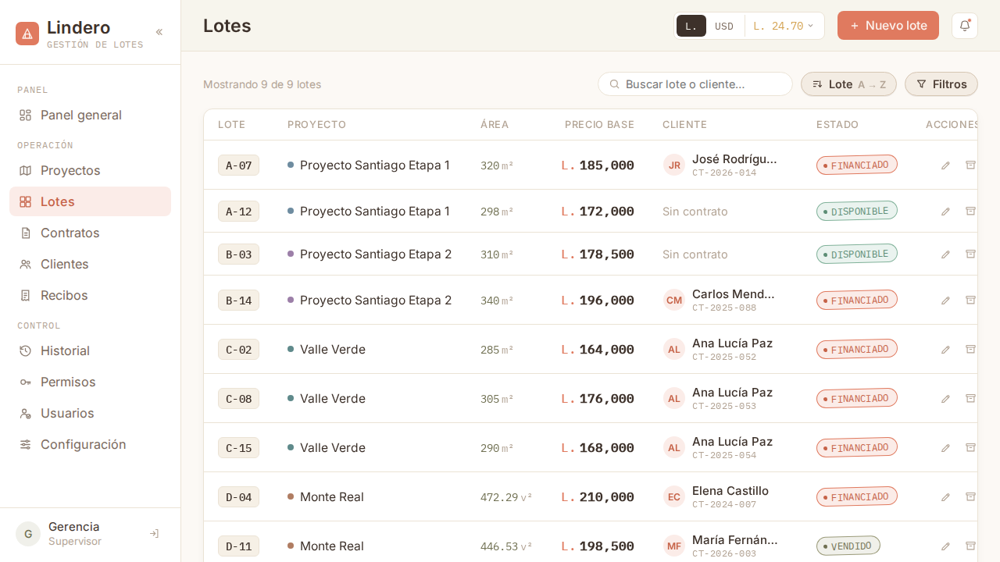
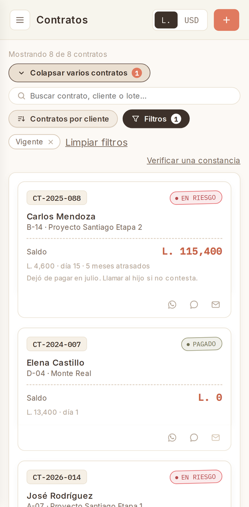
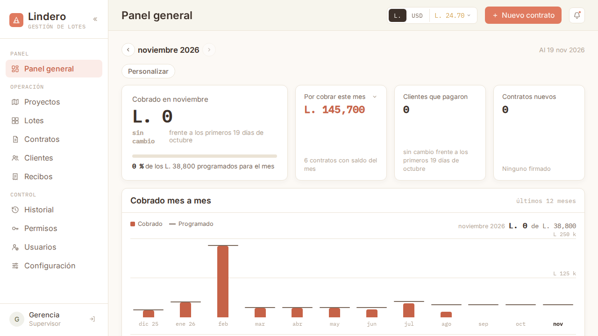
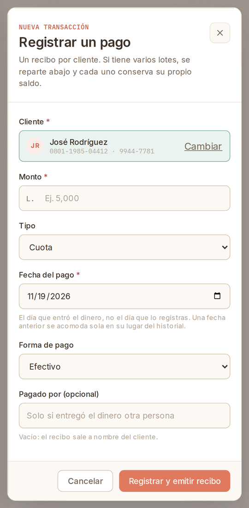

# Lindero

Lindero is a web app for a business that sells land in lots and gets paid in
installments. It keeps one record of every project, lot, customer, contract and
payment, and works out from it what is still for sale, who owes what, and who
is behind.

It was built for a land developer in Honduras and runs there every day. The
screens are in Spanish, amounts are in lempiras (L.) with US dollars alongside,
and it works on a computer or a phone.

<p>
  
  
</p>

<sub>Screenshots use the fictional demo data that comes with the app.</sub>

## What it does

- **Projects and lots.** Every lot shows whether it is available, financed or
  sold. That status comes from the lot's contracts. Nobody types it in.
- **Customers and contracts.** Cash or credit sales, with a down payment
  (*prima*), monthly installments (*cuotas*) and a payment day. A contract can
  be renegotiated with an addendum (*adenda*), so the original one stays as it was.
- **Payments and receipts.** One receipt per payment, even when it covers
  several of the customer's lots. The server numbers receipts in order. A
  receipt can be printed or sent by WhatsApp as an image, and the amount is
  written out in words. The payment that clears a contract gets a final
  receipt, and a paid-off lot gets a certificate (*Constancia de Cancelación
  Total*) to print or send as a PDF.
- **Late fees (*mora*).** The rules live in one settings screen: grace days, a
  percentage or a fixed amount, a maximum per installment, how often. A fee can
  also be charged by hand, one contract can have its own rule, and a fee can be
  forgiven. Each of these needs a reason.
- **Dashboard (*Panel general*).** Money collected against money scheduled,
  month by month, who owes, and late fees charged, collected and forgiven.
- **Two currencies.** Each payment keeps its original currency, amount and the
  exchange rate it was paid at.
- **History (*Historial*).** Changes to payments, contracts, late fees and
  settings record who made them, when, what changed, and why.
- **Users and permissions.** Supervisors and associates. Supervisors decide
  what associates may do.
- **Built for phones too.** Every screen fits a phone. A change made on one
  device shows on the others right away. Proof of payment can be a photo, a PDF
  or a file from Google Drive.

<p>
  
  
</p>

## How it keeps the money right

- Balances, lot status and late-payment status are always worked out from the
  contracts and payments. They are never stored as numbers someone can edit.
- Money is stored as whole centavos, never as decimals.
- Nothing is silently overwritten. A correction is its own entry, with a
  reason, and a receipt that was already handed to a customer never changes.
- The server is the only authority for balances, receipt numbers and who is
  late. The browser only shows what the server worked out.

[docs/architecture.md](docs/architecture.md) explains these rules and why they
matter.

## Built with

| Part | Tools |
|---|---|
| Web app | React 19, TypeScript, Vite. It can be installed on a phone's home screen. |
| Server | Node.js 22+, Fastify, Drizzle ORM, Zod |
| Database | SQLite, one file per business (the reasons are in [architecture.md](docs/architecture.md)) |
| Tests | Node's built-in test runner for the rules; Playwright for the screens, on a desktop-sized and a phone-sized Chrome |
| Hosting | A small Linux server with Nginx and systemd. GitHub Actions runs the tests, builds the app and hands it to the server. |

## Try it on your computer

You need [Node.js](https://nodejs.org) 22 or newer (npm comes with it) and git.

```bash
git clone https://github.com/Elvis-techh/land-management.git
cd land-management
npm install
npm run db:migrate   # create the database file (backend/data/lindero.db)
npm run db:seed      # fill it with fictional demo data; prints the two demo logins
npm run dev          # start the server and the web app together
```

Open <http://localhost:5173> and log in with one of the logins `db:seed`
printed. The server answers on port 3000; `http://localhost:3000/api/health`
says whether it is up.

Settings such as ports and paths have working defaults. To change them, copy
`backend/.env.example` to `backend/.env` and edit it. A real installation never
uses the demo data: `db:seed` refuses to run in production, and
`npm run db:bootstrap` creates the first real account instead.

## Checking a change

```bash
npm run typecheck    # TypeScript, frontend and backend
npm test             # the rules: balances, mora, receipts, permissions…
npm run test:e2e     # the screens, in a real Chrome (first: npx playwright install chromium)
```

All three run on every pull request. [docs/browser-tests.md](docs/browser-tests.md)
explains the browser tests.

## What's where

```text
.
├── frontend/          The web app (React). One folder per screen under src/features/
├── backend/           The server (Fastify) and every money rule. src/lib/ holds the rules
├── e2e/               Browser tests (Playwright)
├── deploy/            Scripts and settings for the production server
├── docs/              How it is built, deployed and planned
└── .github/workflows/ Tests, Browser tests, Deploy, Deploy test, Release and Benchmark
```

## Documentation

| Document | What it covers |
|---|---|
| [product-brief.md](docs/product-brief.md) | What Lindero is for, and the principles behind it |
| [architecture.md](docs/architecture.md) | How it is built, and the rules money must follow |
| [browser-tests.md](docs/browser-tests.md) | What the browser tests check, and how to run them |
| [deployment.md](docs/deployment.md) | Putting Lindero on a server |
| [deployment-shared-droplet.md](docs/deployment-shared-droplet.md) | Running it on a server shared with another app |
| [github-actions-deploy.md](docs/github-actions-deploy.md) | How a change reaches the live site and the test site |
| [receipt-intake.md](docs/receipt-intake.md) | The plan for sharing a payment proof from WhatsApp into Lindero |
| [later-versions.md](docs/later-versions.md) | What is planned, and what waits for paying customers |
| [postgres-readiness.md](docs/postgres-readiness.md) | What moving from SQLite to PostgreSQL would take |

## How changes are made

Every change gets its own branch and pull request, with a test that fails
without it. Changes you can see on screen are tried first on a separate test
site with fictional data. Once a change is merged, the **Deploy** workflow
publishes it, and versions confirmed on the live site are marked as
[releases](https://github.com/Elvis-techh/land-management/releases).
[CLAUDE.md](CLAUDE.md) holds the full working rules, which AI coding sessions
on this repository follow too.
